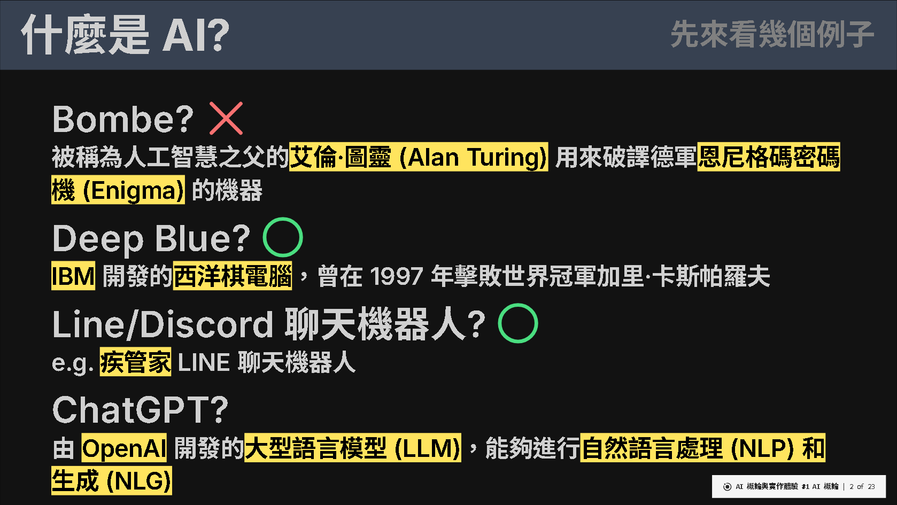
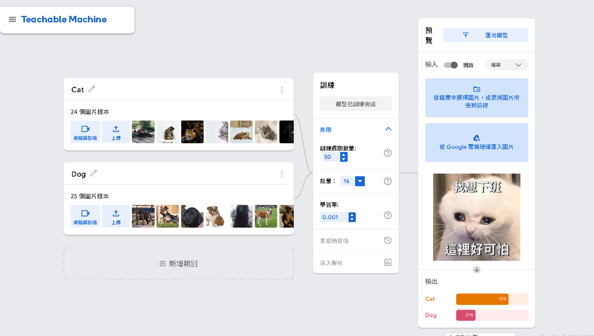
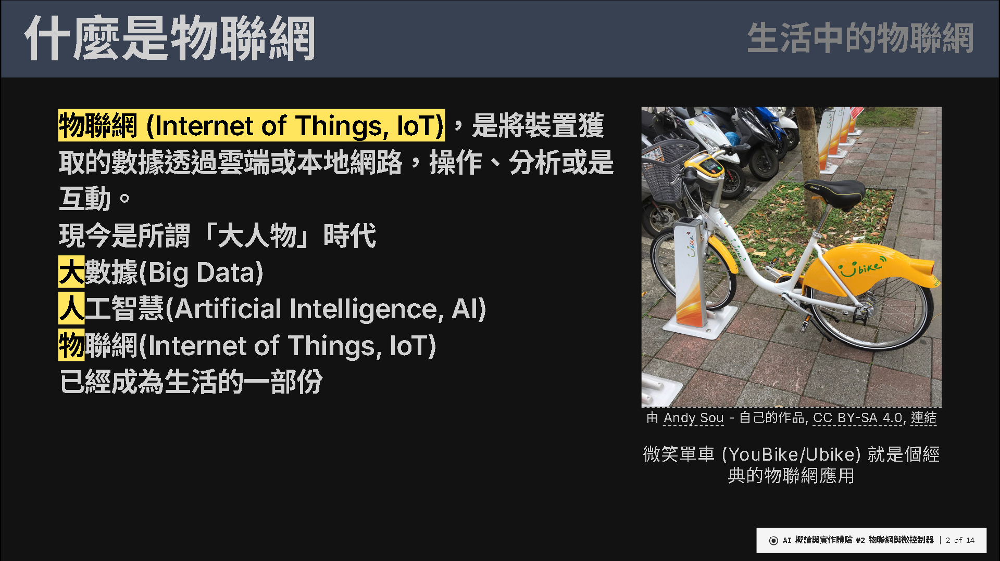
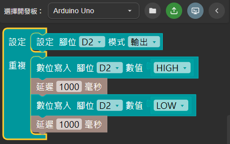

<h1 style="font-size: 2.5rem; font-weight: bold;">AI 概論與實作體驗</h1>
<h1 style="font-size: 5rem; margin-top: 0px; font-weight: bold;">課程簡介</h1>
<h5 style="margin-top: 0px;">11_07 報告版</h5>

---
transition: slide-left
layout: top-title
color: dark
---

::title::

<h1 style="font-size: 3rem; padding-top: 10px; padding-bottom: 10px; font-weight: bold;  display: flex; justify-content: space-between;">
   <span>AI 概論與實作</span><span style="font-size: 2rem; color: gray;">課程簡介</span>
</h1>

::content::

<div style="margin-bottom: 10px;">
    <div style="width: 100%; display: flex; align-items: flex-start; box-sizing: border-box;">
        <div style="width: 50%; padding-right: 20px; box-sizing: border-box;">
            <h2>授課時間：<br>周六 8:30~11:45</h2>
            <h2>授課對象：<br>高一 AI 學程專班學生</h2>
            <h2>課程簡介：<br>以物聯網 (IoT) 為切入點，跳脫純軟體的抽象理論，透過感測器資料收集、執行器操作與邊緣運算，讓學生實際動手體驗人工智慧在現實環境中的應用。</h2>
		</div>
		<div style="width:50%; display: flex; flex-direction: column; align-items: center; text-align: left; box-sizing: border-box;">
			
            物聯網背後有許多概念與 AI 重疊
    	</div>
	</div>
</div>

---
transition: slide-left
layout: top-title
color: dark
---

::title::

<h1 style="font-size: 3rem; padding-top: 10px; padding-bottom: 10px; font-weight: bold;  display: flex; justify-content: space-between;">
   <span>授課重點 (Ⅰ)</span><span style="font-size: 2rem; color: gray;">認識人工智慧</span>
</h1>

::content::

<div style="margin-bottom: 10px;">
    <div style="width: 100%; display: flex; align-items: center; box-sizing: border-box;">
        <div style="width: 70%; padding-right: 20px; box-sizing: border-box;">
            
		</div>
        <div style="width: 30%; box-sizing: border-box;">
            <h2>認識人工智慧近代發展節點與其背後的故事</h2>
		</div>
	</div>
</div>

---
transition: slide-left
layout: top-title
color: dark
---

::title::

<h1 style="font-size: 3rem; padding-top: 10px; padding-bottom: 10px; font-weight: bold;  display: flex; justify-content: space-between;">
   <span>授課重點 (Ⅰ)</span><span style="font-size: 2rem; color: gray;">認識人工智慧</span>
</h1>

::content::

<div style="margin-bottom: 10px;">
    <div style="width: 100%; display: flex; align-items: center; box-sizing: border-box;">
        <div style="width: 30%; padding-right: 20px; box-sizing: border-box;">
            <h2>認識人工智慧進入大眾視線的起點：<br>生成式 AI</h2>
		</div>
        <div style="width: 70%; box-sizing: border-box;">
            
		</div>
	</div>
</div>

---
transition: slide-left
layout: top-title
color: dark
---

::title::

<h1 style="font-size: 3rem; padding-top: 10px; padding-bottom: 10px; font-weight: bold;  display: flex; justify-content: space-between;">
   <span>授課重點 (Ⅱ)</span><span style="font-size: 2rem; color: gray;">人工智慧是如何學習？</span>
</h1>

::content::

<div style="margin-bottom: 10px;">
    <div style="width: 100%; display: flex; align-items: center; box-sizing: border-box;">
        <div style="width: 70%; padding-right: 20px; box-sizing: border-box;">
            
		</div>
        <div style="width: 30%; box-sizing: border-box;">
            <h2>認識人工智慧如何做到與人類同程度的判斷能力</h2>
		</div>
	</div>
</div>

---
transition: slide-left
layout: top-title
color: dark
---

::title::

<h1 style="font-size: 3rem; padding-top: 10px; padding-bottom: 10px; font-weight: bold;  display: flex; justify-content: space-between;">
   <span>授課重點 (Ⅱ)</span><span style="font-size: 2rem; color: gray;">人工智慧是如何學習？</span>
</h1>

::content::

<div style="margin-bottom: 10px;">
    <div style="width: 100%; display: flex; align-items: center; box-sizing: border-box;">
        <div style="width: 30%; padding-right: 20px; box-sizing: border-box;">
            <h2>實作體驗機器學習：<br>如何辨識/分類圖片</h2>
		</div>
        <div style="width: 70%; box-sizing: border-box;">
            
		</div>
	</div>
</div>

---
transition: slide-left
layout: top-title
color: dark
---

::title::

<h1 style="font-size: 3rem; padding-top: 10px; padding-bottom: 10px; font-weight: bold;  display: flex; justify-content: space-between;">
   <span>授課重點 (Ⅲ)</span><span style="font-size: 2rem; color: gray;">人工智慧與物聯網的關聯</span>
</h1>

::content::

<div style="margin-bottom: 10px;">
    <div style="width: 100%; display: flex; align-items: center; box-sizing: border-box;">
        <div style="width: 70%; padding-right: 20px; box-sizing: border-box;">
            
		</div>
        <div style="width: 30%; box-sizing: border-box;">
            <h2>認識物聯網</h2>
		</div>
	</div>
</div>

---
transition: slide-left
layout: top-title
color: dark
---

::title::

<h1 style="font-size: 3rem; padding-top: 10px; padding-bottom: 10px; font-weight: bold;  display: flex; justify-content: space-between;">
   <span>授課重點 (Ⅲ)</span><span style="font-size: 2rem; color: gray;">人工智慧與物聯網的關聯</span>
</h1>

::content::

<div style="margin-bottom: 10px;">
    <div style="width: 100%; display: flex; align-items: center; box-sizing: border-box;">
        <div style="width: 30%; padding-right: 20px; box-sizing: border-box;">
            <h2>物聯網自動化的基礎：<br>Rule-based<br>也正是現代 AI 崛起的關鍵<br>物聯網判斷的關鍵：<br>Fuzzy Logic<br>也是現今機器學習判斷的基礎</h2>
		</div>
        <div style="width: 70%; box-sizing: border-box;">
            
		</div>
	</div>
</div>

---
transition: slide-left
layout: top-title
color: dark
---

::title::

<h1 style="font-size: 3rem; padding-top: 10px; padding-bottom: 10px; font-weight: bold;  display: flex; justify-content: space-between;">
   <span>授課重點 (Ⅳ)</span><span style="font-size: 2rem; color: gray;">實作內容</span>
</h1>

::content::

<div style="margin-bottom: 10px;">
    <div style="width: 100%; display: flex; align-items: center; box-sizing: border-box;">
        <div style="width: 70%; padding-right: 20px; box-sizing: border-box;">
            
		</div>
        <div style="width: 30%; box-sizing: border-box;">
            <h2>探討生活中的常見裝置，並使用物聯網中的大腦—MCU(微控制器)來實現</h2>
		</div>
	</div>
</div>

---
transition: slide-left
layout: top-title
color: dark
---

::title::

<h1 style="font-size: 3rem; padding-top: 10px; padding-bottom: 10px; font-weight: bold;  display: flex; justify-content: space-between;">
   <span>授課重點 (Ⅳ)</span><span style="font-size: 2rem; color: gray;">實作內容</span>
</h1>

::content::

<div style="margin-bottom: 10px;">
    <div style="width: 100%; display: flex; align-items: center; box-sizing: border-box;">
        <div style="width: 50%; padding-right: 20px; box-sizing: border-box;">
            <h2>使用程式積木 (Blockly) 或是簡單的程式語言，重現生活中常見裝置的行為</h2>
		</div>
        <div style="width: 40%; box-sizing: border-box;">
            

```cpp{lines:true}
void setup()
{
  pinMode(2, OUTPUT);
}

void loop()
{
  digitalWrite(2, HIGH);
  delay(1000);
  digitalWrite(2, LOW);
  delay(1000);
}
```      
    
</div>
</div>
</div>

---
transition: slide-left
layout: top-title
color: dark
---

::title::

<h1 style="font-size: 3rem; padding-top: 10px; padding-bottom: 10px; font-weight: bold;  display: flex; justify-content: space-between;">
   <span>授課重點 (Ⅳ)</span><span style="font-size: 2rem; color: gray;">實作內容</span>
</h1>

::content::

<div style="margin-bottom: 10px;">
    <div style="width: 100%; display: flex; align-items: center; box-sizing: border-box;">
        <div style="width: 40%; padding-right: 20px; box-sizing: border-box;">
            <video autoplay loop style="height: auto; width: auto;" src="./public/course1.mp4"></video>
		</div>
        <div style="width: 60%; box-sizing: border-box;">
            <h2>搭配實際接線，實際讓元件以設計的邏輯運作</h2>
		</div>
	</div>
</div>